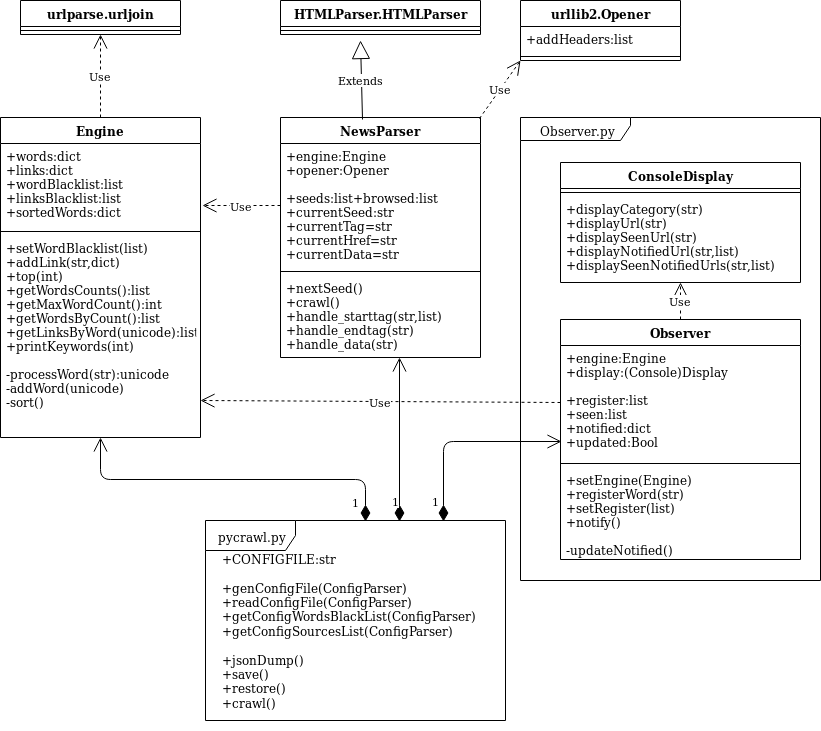

# pycrawl

Every morning, the same security story shows up on twenty news sites under twenty titles. pycrawl crawls them for you, indexes every article link by keyword, and shows you what's trending and what's new, so you read each story once.



## Install and run

Python 3, standard library only:

```bash
git clone https://github.com/twpZero/pycrawl.git && cd pycrawl && python3 pycrawl.py
```

```bash
python3 pycrawl.py         # crawl, then print watched keywords and trends
python3 pycrawlJson.py     # crawl, then write pycrawlfeed.json
python3 interactive.py     # explore the results in a Python shell
```

In the interactive shell:

```python
restore(); crawl(); obs.notify(); save()   # load state, crawl, show watched keywords, save state
eng.printKeyWords(5)                       # words seen at least 5 times
obs.registerWord("ransomware")             # watch a keyword
obs.notify()
```

## Sample output

[pycrawl-feed](https://github.com/twpZero/pycrawl-feed) holds a real `pycrawlfeed.json` produced by `pycrawlJson.py`: watched keywords with their new links, plus the trending words of the run.

## How it works

1. **NewsParser** fetches each source page in `crawl.conf` and collects every link with its text, resolving relative links and skipping pages it already visited.
2. **Engine** splits the link text into words, drops the blacklisted ones (common English and French words, site names, dates…) and builds a word → links index.
3. **Observer** reports the words you watch, and tells apart the links you saw on previous runs (`register.dump`, `links.dump`) from the new ones.

Trending words are just the words with the most links. No ML, no magic (K.I.S.S.).

The implementation details and UML are in the [Wiki](https://github.com/twpZero/pycrawl/wiki). There is also a [FAQ](https://github.com/twpZero/pycrawl/wiki/FAQ).

## Configuration

`crawl.conf` has two sections:

```ini
[Seeds]
sourceslist = https://threatpost.com/,https://thehackernews.com/,…

[Words]
wordblacklist = the,and,security,news,…
```

## When NOT to use this

* **The site renders its articles with JavaScript.** pycrawl reads raw HTML, so it sees nothing there.
* **You need full-text search.** pycrawl indexes link text only, not article bodies.
* **The source has an RSS feed.** Use the feed with any reader, it's more reliable than scraping.
* **The default source list is old.** Some sites in `crawl.conf` have moved or closed since it was written. Review it before you rely on the results.

## Project layout

```
pycrawl.py       crawl, prints watched keywords and trends to the console
pycrawlJson.py   same crawl, writes the JSON feed
interactive.py   Python shell with the crawler loaded
NewsParser.py    HTTP requests and HTML parsing
Engine.py        keyword/link correlation engine
Observer.py      watched keywords and output (console, JSON)
crawl.conf       sources and word blacklist
htmldocs/        generated code documentation
```

Read it once.
